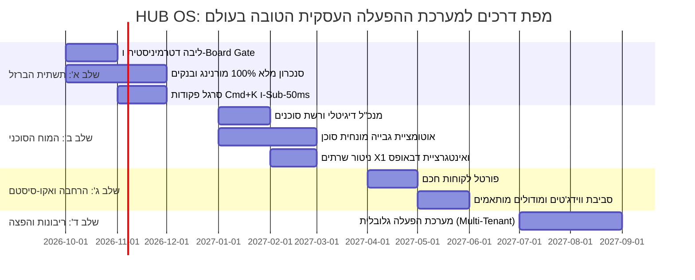

# 🌐 HUB OS — חזון אסטרטגי: מערכת ההפעלה העסקית הטובה בעולם
**מסמך אפיון חזון, ארכיטקטורה, UX וערך עסקי אולטימטיבי**  
*גרסה:* v1.0 Final | *תאריך:* 2026-09-29 | *סטטוס:* מאושר אסטרטגית | *סיווג:* מסמך ליבה (Enterprise Master Charter)

---

## 🧭 תקציר מנהלים (Executive Summary)

עולם ה-SaaS הארגוני שבור. עסקים מודרניים קורסים תחת עומס של 15–30 מערכות נפרדות: CRM, הנהלת חשבונות, ניהול משימות, אחסון ושרתים, וואטסאפ, מיילים, ניהול זמן וכספות סיסמאות. התוצאה היא פיצול נתונים, עבודה ידנית סיזיפית, עלויות רישוי מנופחות וצוואר בקבוק ניהולי קבוע.

**HUB OS** איננה עוד "תוכנת ניהול" או דשבורד סטטי — היא **מערכת הפעלה עסקית מלאה (Autonomous Business OS)**.  
בהשראת תפיסת העומק של **"הכל צפוי והרשות נתונה"**, המערכת לוקחת על עצמה 100% מהכאוס, הבירוקרטיה, הסנכרון והחישובים ("הכל צפוי"), כדי לשחרר את התודעה והיצירתיות של ההנהלה האנושית להובלה, יזמות וצמיחה ("הרשות נתונה").

מסמך זה מפרט כיצד HUB OS מזנקת מעל המתחרים העולמיים (monday, Salesforce, Odoo, Palantir) באמצעות ארכיטקטורת ליבה דואלית, חוויית משתמש בעלת שיהוי אפסי (Sub-50ms), אונטולוגיית נתונים הוליסטית ומוח סוכני אוטונומי ומבוקר.

---

## 🔍 ניתוח שוק והשוואה בינלאומית (The Global Landscape)

כדי להיות הטובים בעולם, עלינו לזהות את החולשות המבניות של ענקיות הטכנולוגיה:

| פלטפורמה | נקודות חוזק | כשלים וחולשות קריטיות | היתרון המוחץ של HUB OS |
| :--- | :--- | :--- | :--- |
| **monday.com (Work OS)** | ממשק ויזואלי מושך, לוחות גמישים, אוטומציות פשוטות | מעטפת פרויקטים בלבד; ללא שרתים/ענן, ללא הנה"ח מובנית, חוסר יכולת לפעול כאוטונומיה עסקית עמוקה | **מערכת הפעלה הוליסטית:** חיבור טבעי בין שרתי ענן, גבייה, הנה"ח ופרויקטים |
| **Salesforce (Agentforce)** | אקו-סיסטם ענק, מותאם לתאגידי ענק | סרבול קיצוני, עלויות עתק, UX מיושן ואיטי, דורש צבא של מטמיעים ומפתחים | **Sub-50ms ופשטות קיצונית:** שמישות מיידית, אפס סרבול, ללא תקורה ארגונית |
| **Odoo / Zoho One** | מודולריות רחבה (ERP + CRM + הנה"ח) | תחושה של 40 אפליקציות מודבקות, חוסר אחידות עיצובית, אפס אינטליגנציה סוכנית עצמאית | **אונטולוגיה אחת אחידה:** ישות אחת זורמת מקצה לקצה ללא תפרים או פיצולים |
| **Palantir Foundry / AIP** | אונטולוגיית נתונים מושלמת, עוצמה אנליטית | מיועד לביטחון ולתאגידי Fortune 500 בלבד; עלויות של מיליונים, ממשק בלתי קריא לאדם הפשוט | **עוצמת Enterprise לעסקים צומחים:** ממשק אלגנטי, אינטואיטיבי ובר-השגה |
| **Linear / Raycast** | חוויית משתמש וארגונומיה מושלמת, Keyboard-First | כלים נקודתיים בלבד (ניהול באגים או משגר פקודות למחשב) | **אימוץ ארגונומיית הקצה אל תוך ליבת ה-Business OS** |

---

## 🎨 נדבך 1: ה-UX והארגונומיה הטובים בעולם (The Sovereign Cockpit)

מערכת הפעלה עסקית אינה צריכה להיראות כמו טופס ממשלתי אלא כמו **קוקפיט של מטוס קרב מתקדם**:

### 1. שיהוי אפסי ותגובתיות מיידית (Sub-50ms Optimistic UI)
- **Zero Spinners:** כל פעולה (יצירת ליד, סגירת משימה, עדכון סטטוס גבייה) מתעדכנת מקומית מיידית (Optimistic Update) ומסונכרנת ברקע.
- **Local-First Caching:** המערכת פועלת גם במצבי ניתוק רשת ושומרת על שטף מחשבתי (Flow State).

### 2. משגר פקודות גלובלי (Command Palette — `Cmd+K` / `Ctrl+K`)
- ביצוע כל פעולה עסקית מכל מסך באמצעות המקלדת תוך 2 שניות:
  - `הוצא חשבונית מס ללקוח אדר26 על סך 5,000 ש"ח`
  - `סנכרן תנועות בנק מול מורנינג`
  - `בדיקת עומס שרת X1 וזיכרון RAM`
  - `פתח פרויקט חדש: שדרוג שרתים`

### 3. מחוון מצב חי (Ambient Executive HUD)
- סרגל עליון מינימליסטי המציג בכל רגע נתון את "הדופק של העסק":
  - **נזילות חיה (Liquid Cashflow):** יתרה אמיתית לאחר התחשבות בהוצאות קבועות והכנסות צפויות.
  - **מצב גבייה (Collections Pulse):** חובות פתוחים מול ימי פיגור ממוצעים.
  - **סטטוס תשתיות (Cloud Health):** שרתים, דומיינים ותעודות SSL פעילות.
  - **פעילות סוכנים (Agent Swarm Activity):** כמה משימות רקע פועלות כעת.

### 4. ארגונומיה RTL-First ועיצוב ויזואלי עשיר
- טיפוגרפיה עברית מתקדמת, היררכיה ברורה, ללא שבירות שורה מעוותות.
- עיצוב כהה יוקרתי (Deep Slate / Obsidian) עם נגיעות צבע מודרניות (Emerald לכספים, Tangerine לפעולה, Indigo לתשתיות).

---

## 🏗️ נדבך 2: ארכיטקטורה וליבת מערכת (Dual-Core Architecture)

כדי לעמוד בכלל הוודאות (100%) ובחוקי האתיקה, HUB OS בנויה על הפרדה מוחלטת בין שתי ליבות:

```
┌────────────────────────────────────────────────────────┐
│               Sovereign Executive Cockpit               │
│        (React 19 + Vite + Tailwind + Cmd+K + HUD)      │
└───────────────────────────▲────────────────────────────┘
                            │
┌───────────────────────────┴────────────────────────────┐
│                    API Gateway & IPC                   │
└─────────────┬────────────────────────────┬─────────────┘
              ▼                            ▼
┌───────────────────────────┐┌───────────────────────────┐
│     Core A: Deterministic  ││     Core B: Cognitive     │
│       Business Kernel     ││        Agent Mesh         │
│  ───────────────────────  ││  ───────────────────────  │
│  • הנהלת חשבונות דטרמיניסטית││  • מנכ"ל דיגיטלי (Digital CEO)│
│  • סנכרון בנק ומורנינג (305 vs 320)││  • סוכן גבייה ותקשורת      │
│  • ניהול תשתיות ושרתים X1 ││  • סוכן תחקיר עסקי        │
│  • בקרת הרשאות ואבטחה      ││  • סוכן תפעול ודבאופס     │
│  • 100% ACID, אפס הזיות   ││  • ניתוח מגמות וסיכומים   │
└─────────────┬─────────────┘└─────────────┬─────────────┘
              │                            │
              ▼                            ▼
┌────────────────────────────────────────────────────────┐
│             Board Gate & Sandbox Protocol              │
│    (איסור יציאה עצמאית לעולם החיצון / אישור אנושי)     │
└───────────────────────────▲────────────────────────────┘
                            │
┌───────────────────────────┴────────────────────────────┐
│              Unified Business Ontology                 │
│         (Postgres / SQLite WAL + Cloud Firestore)       │
└────────────────────────────────────────────────────────┘
```

### 1. Core A: הליבה הדטרמיניסטית (The Deterministic Kernel)
- **אפס טעויות חשבונאיות:** יישום קפדני של חוק המסמך החשבונאי (חשבונית מס 305 = עסקה/הכנסה; קבלה 320/400 = תשלום; אין כפל ספירה לעולם).
- **קריאה בלבד למערכות רגישות (Morning / בנקים):** מניעת שינוי או השחתת נתונים.
- **שליטה על התשתיות:** ניהול שרתי ה-Cloud, ניטור זיכרון (OOM Prevention), גיבויים אוטומטיים וניהול DNS.

### 2. Core B: רשת הסוכנים האוטונומית (The Cognitive Agent Mesh)
- **Digital CEO:** מנתח את כלל הפעילות העסקית, מזהה צווארי בקבוק ומציע תוכניות פעולה ממוקדות.
- **CFO Agent:** מנתח דוחות תזרים, מתריע על חריגות תקציב, ומכין טיוטות גבייה מותאמות אישית.
- **DevOps Agent:** מנטר זמני תגובה, תעודות SSL ושטחי אחסון של כלל לקוחות ה-Hosting.

### 3. שער הדירקטוריון (The Board Gate Protocol)
- שום סוכן AI אינו מוציא מייל, אינו מחייב אשראי, ואינו משנה הגדרות שרת ללא אישור מפורש של הבעלים (אשר).
- הפרדה זו מונעת סיכונים תפעוליים ומבטיחה ביצוע מושלם לצד שליטה אנושית מלאה.

---

## 📊 נדבך 3: אונטולוגיית נתונים וריכוז מידע (Single Source of Truth)

ב-HUB OS, המידע אינו מפוזר בטבלאות מנותקות אלא מקושר כגרף ישויות אחוד (Entity Graph):

```
[לקוח: אדר26]
   ├── [חוזים וריטיינרים] ──► [תזרים צפוי חודשי]
   ├── [שרת אחסון ודומיין] ──► [ניטור משאבים ובריאות]
   ├── [פרויקטים ומשימות] ──► [שעות עבודה בפועל]
   ├── [חשבוניות מס (305)] ──► [הכנסה מוכרת]
   └── [קבלות (320)] ────────► [התאמת בנק וסגירת חוב]
```

### יתרונות האונטולוגיה האחודה:
1. **חיתוך רווחיות אמיתי (True Client Margin):** המערכת יודעת אוטומטית לחשב הכנסות פחות עלויות שרתים, שעות עבודה והוצאות ישירות עבור כל לקוח בלחיצת כפתור.
2. **אוטומציית גבייה חכמה:** אין צורך לבדוק ידנית מי שילם; המערכת מצליבה קבלות מחשבונית ירוקה מול חשבוניות פתוחות ויוצרת רשימת גבייה מדויקת 100%.
3. **כספת מרכזית (Vault):** ניהול מאובטח ומרוכז של גישות, סיסמאות, שרתים ותעודות לכל לקוח תחת הרשאות קפדניות.

---

## 💎 נדבך 4: הערך העסקי האולטימטיבי (The Economic Moat)

1. **חיסכון של 80% בעלויות תוכנה:** החלפת שורת מנויים יקרים (CRM, Task Manager, Hosting Manager, Billing Dashboard) בפלטפורמה אחת שלמה.
2. **הכפלת קיבולת ללא תוספת כוח אדם (10x Scale):** עסק יכול לנהל פי 5 יותר לקוחות ופרויקטים מבלי להגדיל את התקורה האדמיניסטרטיבית.
3. **האצת תזרים ומזעור חובות אבודים:** תהליכי התאמה וגבייה אוטומטיים שמקצרים את ימי האשראי (DSO) ומגנים על הנזילות.
4. **דביקות לקוח מוחלטת (Zero Churn):** כשהתשתיות, הנתונים והאוטומציה העסקית פועלים בסנכרון מושלם, הפלטפורמה הופכת לעמוד השדרה שאי אפשר להחליף.

---

## 🚀 מפת דרכים ואבני דרך להקמה (Strategic Roadmap)



### שלב א': תשתית הברזל (החודשיים הקרובים — Q4 2026)
- **ביסוס הליבה הדטרמיניסטית:** בדיקות E2E מלאות לכל פעולות הכספים, יישום קפדני של חוק המסמך החשבונאי (305 vs 320), אימות נתונים ללא הזיות.
- **השקת ה-Command Palette (`Cmd+K`):** ניווט וביצוע פקודות תוך עשיריות שנייה.
- **אופטימיזציית ביצועים:** מעבר מלא ל-Optimistic UI ו-IndexedDB מקומי.

### שלב ב': המוח הסוכני האוטונומי (Q1 2027)
- **רשת סוכני HUB:** הטמעת המנכ"ל הדיגיטלי, סוכן הגבייה וסוכן התשתיות תחת פרוטוקול Board Gate קשיח.
- **שילוב נתוני WhatsApp ויומן:** תמלול פגישות אוטומטי, יצירת סיכומי מנהלים והזנת משימות חיה.

### שלב ג': האקו-סיסטם והפורטלים (Q2 2027)
- **Agent Portal & Client Portal:** ממשק ייעודי ללקוחות לצפייה בשעות, פרויקטים, חשבוניות ודוחות שרתים.
- **סביבת הרחבה (App Engine):** מודולים גמישים לכל תחום עסקי (איקומרס, שירותים מקצועיים, אחסון אתרים).

### שלב ד': ריבונות והפצה עולמית (Q3 2027 ואילך)
- **Multi-Tenant Federation:** יכולת פריסה מהירה לכל עסק בעולם במודל ענן פרטי ריבוני.
- **Benchmark הובלה בינלאומי:** מיצוב HUB OS כחלופה הטובה, המהירה והחכמה בעולם ל-monday ו-Salesforce.

---

## ⚖️ הצהרת מחויבות אתית ומוסרית
HUB OS מפותחת ומנוהלת תחת עשרת הדיברות: ללא גזל מידע, ללא עדות שקר (אפס הזיות נתונים), בשקיפות מלאה מול הבעלים, ותוך שמירה קפדנית על פרטיות ואבטחת המידע של כל לקוח ושותף.
